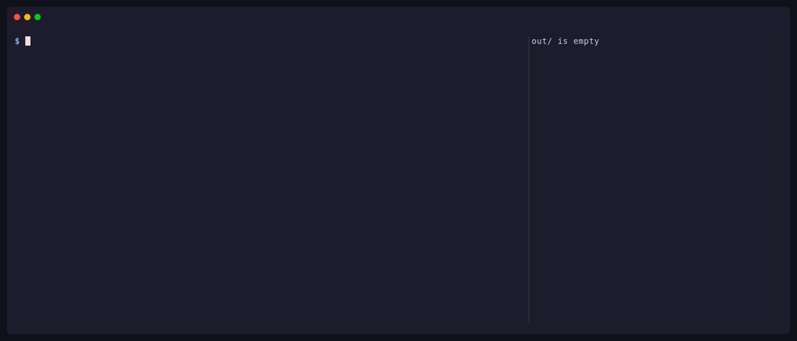

# untauri

Get the web frontend (HTML, CSS, JS, fonts, images) back out of a compiled Tauri app.



Tauri doesn't ship your frontend as loose files. It compresses every file and bakes
it into the executable, with a lookup table of names. untauri reads that table and
writes every file back out under its original name.

## Install

```
cargo install untauri
```

## Usage

```
untauri MyApp.app -o out          # macOS bundle
untauri ./my-app -o out           # any executable: Linux ELF, Windows .exe, Mach-O
```

Linux packages need unpacking first. None of these run the app:

```
dpkg-deb -x MyApp.deb pkg          # .deb
rpm2cpio MyApp.rpm | cpio -idm     # .rpm
7z x MyApp.AppImage -opkg          # .AppImage (don't use --appimage-extract, it runs the app)
untauri pkg/usr/bin/my-app -o out
```

For Windows, `7z x MyApp.msi -omsi` gets you the `.exe`.

| Flag | |
|---|---|
| `-o, --out <DIR>` | Output directory (default `unpacked`) |
| `--tree` | Keep the app's own folder layout, so you can serve the output directly |
| `--strict` | Exit non-zero if any file failed to extract |
| `--manifest-only` | Only write `assets.json` |
| `--raw` | Also write streams that don't look like web files (fallback mode only) |
| `-v, --verbose` | Print every asset to stderr |

By default files are grouped by type (`js/`, `css/`, `font/`, ...). `--tree` writes them
where the app expects them (`index.html`, `assets/index-BzYEIace.js`). Either way you
get `assets.json`, listing each file's name, size and offset in the binary.

After extracting, untauri also scans the recovered JS, CSS and HTML for files they
reference and tells you about any that aren't in the app. Those are usually loaded from
the network or never used.

## Tested on

Every file, under its real name, compared byte for byte against the app's own table:

| App | Platform | Files |
|---|---|---|
| Modrinth | Linux | 877 |
| Surrealist | Linux, macOS arm64 | 648 |
| Jan | Linux, macOS universal | 559 |
| Yaak | Linux | 321 |
| Clash Verge Rev | Linux | 275 |
| Spacedrive | Linux | 200 |
| Pot | Linux | 180 |
| Kanri | Linux, macOS arm64 + x64, Windows | 61 |
| Pake (ChatGPT) | Linux | 1 |

Each one takes under a second.

## How it works

Tauri's build step turns your `dist/` folder into a `phf::Map<&str, &[u8]>`: an array
of `(path, bytes)` pairs compiled into the binary. untauri finds that array by its shape
(a run of 32-byte entries, each holding a pointer to a `/path` string and a pointer to
its data), resolves the pointers for the binary's format (ELF relocations, Mach-O
chained fixups, plain PE addresses) and decompresses each entry. Apps built without
Tauri's `compression` feature (Jan, for one) store files uncompressed, and those are
read directly.

If no table is found, untauri falls back to scanning the binary for brotli streams. That
mode is a best guess: it can miss files, lose names, and pick up noise, and it says so
when it runs.

## Compared to tauri-dumper

[tauri-dumper](https://github.com/Mas0nShi/tauri-dumper) reads the same table and got
identical output on every app above that it could open. It can also patch files back
into a binary, which untauri can't. untauri additionally handles:

- apps built without compression (tauri-dumper finds nothing in Jan)
- universal macOS binaries
- binaries with no readable table, through the fallback scanner
- checking the recovered code for references to missing files

## Limits

- Each file is capped at 64MB decompressed, as a guard against decompression bombs.
  The largest real asset seen so far is 11.4MB. A file over the cap is reported, not
  silently dropped.
- The table reader handles 64-bit binaries. 32-bit builds (i686 Windows, for example)
  fall back to the scanner.
- You get the built frontend, not your source: minified, bundled, without the Rust side.

## Why

To audit what an app actually ships (API keys in the JS, anyone?), or to recover your
own frontend after losing the source. Not for cloning other people's apps.

## License

MIT
